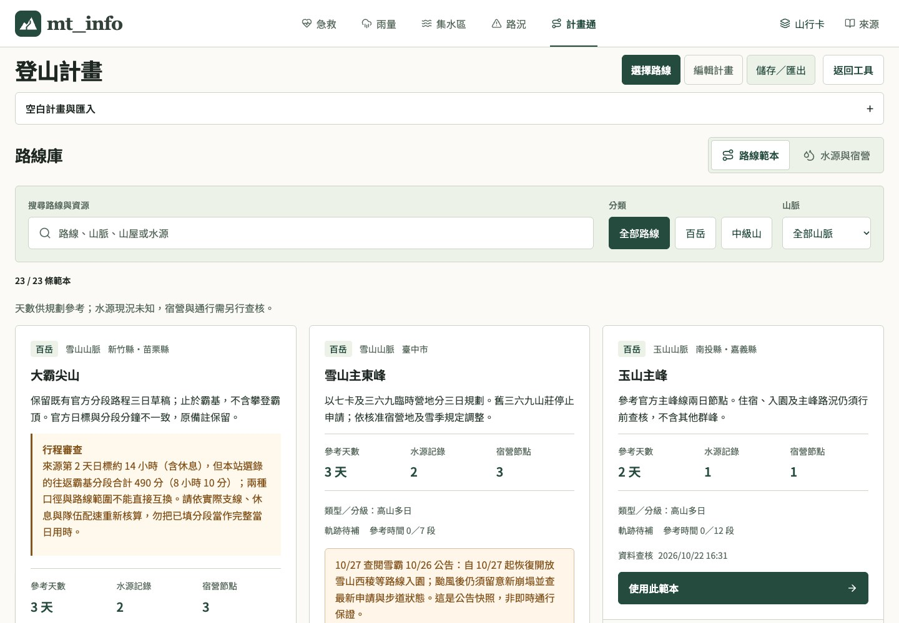

# mt_info

手機優先的臺灣山區資訊工具，整合急救設備、官方雨量圖、路況公告與登山計畫。

[文件](docs/README.md) · [參與開發](CONTRIBUTING.md) · [資料來源](docs/DATA_SOURCES.md) · [MIT 授權](LICENSE)

目前為開發版本，可在本機執行；尚未公開部署正式網站。各項資訊保留來源、原始時間及未知狀態，協助行前查詢與人工核對。

## 主要功能

| 工具 | 提供的功能 | 詳細說明 |
| --- | --- | --- |
| 急救設備 | 全臺 AED 名錄、少量 PAC／急救箱公告種子、搜尋與地圖 | [來源與覆蓋範圍](docs/DATA_SOURCES.md) |
| 雨量 | 氣象署 6／12 小時累積雨量圖、時段播放與縮放、MPAS 官方原頁 | [產品與時間限制](docs/RAIN_MAP_SOURCES.md) |
| 路況與警示 | 步道公告、公開 CAP 示警、分區搜尋及來源狀態 | [路況說明](docs/CONDITIONS.md) |
| 集水區 | 官方既有子集水區邊界與屬性查詢 | [圖層來源與限制](docs/DATA_SOURCES.md#集水區與底圖) |
| 計畫通 | 路線庫、逐日行程、本機草稿、JSON／Word 與列印匯出 | [計畫操作](docs/PLAN_GENERATOR.md) |
| 出發吧！ | 待確認事項、獨立備案與逐日比較、已對應步道的公告重新查核 | [行前整理](docs/DEPARTURE.md) |
| 山行卡 | 山行偏好測驗、原創卡面、本機收藏與卡片匯出 | [山行卡說明](docs/FIELD_CARDS.md) |

## 介面預覽



[查看手機畫面](docs/images/route-library-mobile.jpg)。截圖取自 2026-11-17 的隔離本機測試，未使用私人計畫或聯絡資料；圖中的來源日期與公告是當時收錄內容，不代表目前通行狀態。

## 快速啟動

建議使用 **Node.js 24** 與 npm。

```sh
git clone https://github.com/yhsindev/mt_info.git
cd mt_info
npm ci
cp .env.example .env
AED_AUTO_SYNC=false npm run dev
```

開啟 <http://127.0.0.1:5173>。前端由 Vite 提供，API 預設在 `127.0.0.1:8787`，透過 Vite 代理連線。兩個埠需可使用。

這個啟動方式會停用 AED 背景換版，適合先查看介面；路況與示警的定期查核仍會執行。若要啟用 AED 自動更新，將 `.env` 的 `AED_AUTO_SYNC` 設為 `true`，再以 `npm run dev` 啟動。

沒有氣象署授權碼時，官方雨量圖及 MPAS 原頁仍可開啟；需要授權的氣象數值產品會顯示未設定。正式來源、底圖與圖磚需要網路。

## 環境設定

由 `.env.example` 建立本機 `.env`，金鑰只供伺服器使用。

| 變數 | 用途 | 預設／目前狀態 |
| --- | --- | --- |
| `CWA_API_KEY` | 已實作氣象數值產品的授權碼 | 空白；各產品仍需核對權限與介接狀態 |
| `NCDR_API_TOKEN` | 預留的 WATCH 數值服務設定 | 目前未啟用；公開 CAP 與 MPAS 原頁不需要此 Token |
| `PORT` | API 連接埠 | `8787` |
| `AED_AUTO_SYNC` | AED 名錄背景更新 | 未設時啟用；介面開發建議設為 `false` |
| `AED_SYNC_INTERVAL_HOURS` | AED 檢查間隔 | `24`，可設 `1–168` 小時 |

授權產品與尚待核實的格點功能見[氣象介接說明](docs/WEATHER.md)；快取、排程與更新失敗行為見[自動更新說明](docs/AUTO_UPDATE.md)。

## 驗證與正式編譯

```sh
npm run check:public
npm test
npm run build
```

[GitHub Actions](https://github.com/yhsindev/mt_info/actions/workflows/ci.yml) 會在 push 與 PR 執行相同檢查。瀏覽器操作測試另需 Playwright 與 Chrome，執行方式見[參與開發](CONTRIBUTING.md)。

編譯後可用 `AED_AUTO_SYNC=false npm start` 在 <http://127.0.0.1:8787> 查看本機正式編譯版。雲端監聽位址、持久快取與排程仍需另外配置，見[部署說明](docs/DEPLOYMENT.md)。已知套件安全問題見[安全說明](SECURITY.md)。

## 資料、隱私與使用限制

- 設備登錄與歷史巡檢不代表目前可用。PAC／急救箱僅收錄少量公告，座標未知者保留文字資訊。
- 官方雨量圖保留原始時間與色階；圖片載入成功不表示預報仍有效。來源空清單、未知水情或公告未再列出，都不能當作已開放或可安全通行。
- 路線與計畫供人工規劃；GPX 不提供導航，參考線可能缺段。水源、住宿、許可與撤退需另行查核，雨量與集水區也不產生安全判定。
- 計畫、備案與聯絡資料只存於目前瀏覽器；自行匯入的 GPX 留在記憶體。清除瀏覽器資料可能移除草稿，重要內容請自行匯出備份。

完整的來源、發布／查核時間、授權與涵蓋限制見[資料來源清冊](docs/DATA_SOURCES.md)及[第三方聲明](THIRD_PARTY_NOTICES.md)。官方地圖與字型服務仍會收到正常資源請求；定位與本機處理方式見[功能細節](docs/FEATURES.md#資料與功能界線)。

## 文件與參與

由 [yhsindev](https://github.com/yhsindev) 維護。歡迎提出可重現的問題、資料更正與功能建議。

- [文件索引](docs/README.md)：操作指南、技術參考與設計背景。
- [功能細節與實作背景](docs/FEATURES.md)：完整功能、來源差異及歷史驗證脈絡。
- [CONTRIBUTING.md](CONTRIBUTING.md)：開發流程、Linux kernel 風格的提交訊息與 PR 說明。
- [Issues](https://github.com/yhsindev/mt_info/issues)：功能建議與一般問題；請使用虛構資料重現，敏感問題依 [SECURITY.md](SECURITY.md) 回報。

## 授權

原創程式碼採 [MIT License](LICENSE)。政府資料、OSM、第三方套件與來源引用依各自條款使用，詳見 [THIRD_PARTY_NOTICES.md](THIRD_PARTY_NOTICES.md)。
